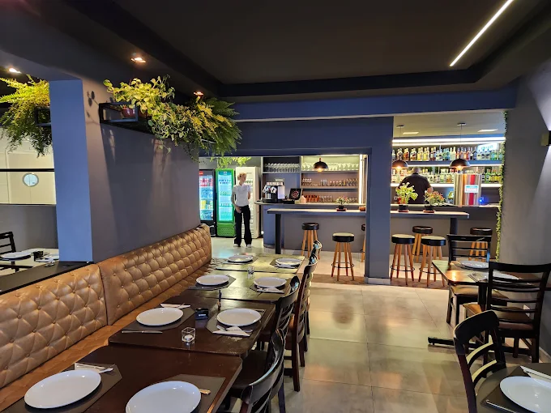

# Rock Me Mamma · Pizza Bar Experience

Site cardápio do Rock Me Mamma, pizza bar na Al. Júlia da Costa, 1829, no Bigorrilho, em Curitiba. É um site estático (HTML, CSS e JavaScript puros), sem build, pronto para publicar na Netlify.

## Estrutura

```
index.html        Página única: abertura, cardápio completo, como chegar e rodapé
css/style.css     Estilos (cores e fontes no topo, em :root)
js/main.js        Busca, filtros e destaque da categoria durante a rolagem
js/book.js        Cardápio em formato de livro, aberto pelo botão "Abrir o cardápio"
js/gallery.js     Carrossel de fotos da seção "A casa"
js/vendor/        GSAP 3.12.5 (licença gratuita da GSAP), servido pelo próprio site
assets/           Logo (branca e preta), favicon, imagem de compartilhamento, textura do papel e a pizza da abertura (hero-pizza.webp)
```

O cardápio e os contatos estão escritos direto no `index.html`, então aparecem em qualquer celular ou navegador, mesmo com o JavaScript bloqueado. Com o JavaScript ativo, essa mesma lista é montada como um livro; sem ele, ou em telas baixas demais para um livro legível (celular deitado), a lista aparece normalmente.

## Recursos

- **A casa:** descrição do restaurante com título em letra de pincel (Mr Dafoe, como o "Mamma" do logo) e texto em Montserrat (como o "ROCK ME"), ao lado de um carrossel de fotos do ambiente e dos pratos. O carrossel desliza com o dedo, tem setas, pontinhos, teclado e troca de foto sozinho enquanto está na tela.
- **Cardápio em livro:** na página aparece o livro fechado, o botão **"Abrir o cardápio"** e atalhos para cada categoria; rolar o site passa direto, sem folhear. O livro abre em tela cheia, por cima do site, com capa, boas-vindas, sumário clicável, páginas do cardápio e contracapa. Duas páginas abertas no computador e uma por vez no celular.
- **Navegação do livro:** as páginas viram em 3D com a roda do mouse (uma página por movimento), as setas do teclado, os botões de anterior e próxima, um clique na página ou deslizando o dedo no celular. Tem a lista "Ir para…" com as categorias, indicador da página e barra de progresso. Fecha no "Fechar", no Esc ou no botão voltar do celular, e o site continua onde estava. O botão "Ver o cardápio" da abertura e os links "Cozinha" e "Bar" do topo abrem o livro na página certa.
- Cardápio inteiro do PDF, separado em **Cozinha** e **Bar**, com títulos em letra cursiva como no cardápio impresso.
- Busca por nome ou ingrediente (sem diferenciar acentos), com botão de busca no topo do site e na barra de categorias, contador de resultados e filtros **Vegetariano**, **Vegano** e **Zero lactose**. No modo livro, os resultados aparecem em lista com a página de cada item; tocar em um resultado abre o livro nessa página e destaca o prato.
- Seção "Visite" com endereço, mapa (com alternativa caso o mapa não carregue), rota no Google Maps, WhatsApp e Instagram.
- Botões flutuantes: **Cardápio** (à esquerda, abre o livro de qualquer ponto da página), WhatsApp e **voltar ao início** (à direita). Os de cardápio e de voltar aparecem depois da abertura; o logo do topo também leva ao início.

## Como atualizar o cardápio

O livro é montado a partir da lista do `index.html`, então basta editar a lista: as páginas, o sumário e os números de página se refazem sozinhos.

No `index.html`, cada categoria começa com um comentário (ex.: `<!-- Pizzas Tradicionais -->`) e cada item é um bloco `<li class="item">`:

- **Mudar preço:** troque o número dentro de `<span class="price__val">67</span>`.
- **Mudar nome ou descrição:** edite o texto em `item__name` ou `item__desc`.
- **Remover um item:** apague o bloco do `<li class="item">` até o `</li>` correspondente.
- **Adicionar um item:** copie um bloco parecido e altere o texto.
- **Vegetariano, vegano ou sem lactose:** use `data-tags="veg"`, `"vegan"` ou `"lac"` no `<li>` (é o que os filtros usam) e copie o ícone `<span class="tag ...">` de outro item.

Contatos (WhatsApp, Instagram e endereço) também ficam no `index.html`; procure por `wa.me`, `instagram.com` e `Júlia da Costa`.

## Como colocar as fotos no carrossel

O carrossel já tem 5 fotos (salão, pizza Burrata e três drinks), em `assets/galeria/`. Para trocar ou adicionar:

1. Salve a foto em `assets/galeria/`. De preferência na vertical (4:5), com pelo menos 900 px de altura para ficar nítida em telas de alta resolução, e no máximo uns 1600 px, para carregar rápido.
2. No `index.html`, procure por `gallery__track` e copie uma das linhas de foto, trocando o arquivo e a descrição:

```html
<figure class="gallery__slide"></figure>
```

Pode colocar quantas fotos quiser; os pontinhos se ajustam sozinhos. O `alt` descreve a foto para quem usa leitor de tela.

## Publicar na Netlify

Arraste a pasta do projeto em https://app.netlify.com/drop, ou conecte este repositório (sem comando de build, diretório de publicação `.`).
